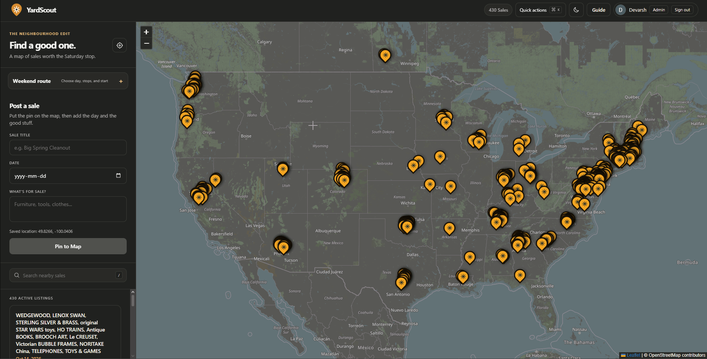

<div align="center">
  <h1>YardScout</h1>
  <p><strong>Find a good one.</strong><br>Discover neighborhood garage sales and plan a better Saturday.</p>

  <p>
    <a href="https://yardscout.onrender.com"></a>
    
    
    <a href="./LICENSE"></a>
  </p>

  <a href="https://yardscout.onrender.com">
    
  </a>
</div>

<div align="center">
  
</div>

---

## What is YardScout?

YardScout helps people find nearby garage sales, browse them on a map, and plan a route between stops. It also includes a separate admin area for reviewing listings and running the supported scrapers.

**[Open the live site](https://yardscout.onrender.com)** · **[See the roadmap](./ROADMAP.md)** · **[Read the license](./LICENSE)**

## Features

- **Find sales:** Browse map pins and listings, search nearby, and open a sale for details.
- **Plan a route:** Choose a weekend date, add up to eight sales, pick a starting point, and get an estimated driving order. Open the stops in Google Maps for directions.
- **Post a listing:** Add a sale location, date, title, and description.
- **Admin tools:** Review listings, add sales, extract text from screenshots, run supported scrapers, check scan progress, and download a private data backup.
- **Automatic cleanup:** Listings are removed after the sale date has passed by seven days.

The route planner requests estimates from the public OSRM service. It has no live traffic or service guarantee, and YardScout does not save routes.

## Scraper coverage

YardScout only runs sources with supported access:

| Source | Current coverage |
|---|---|
| eBrandon | Garage-sale listings around Brandon, Manitoba |
| GarageSaleFinder | Owner-authorized pages for U.S. locations |
| Ticketmaster | Optional event lookup when an API key is configured |

The resumable regional scan checks 70 hubs; it is not an exhaustive North American crawl. Facebook Marketplace, Kijiji, Craigslist, and other sites are not automatically scanned without approved access.

## Run locally

Requires Python 3.12 or newer.

```powershell
git clone https://github.com/DevarshP610/YardScout.git
cd YardScout
py -3.12 -m venv .venv
.\.venv\Scripts\Activate.ps1
python -m pip install -r requirements.txt
```

Set the required app and Google OAuth values in your PowerShell session. Register `http://127.0.0.1:8080/auth/callback` as an authorized redirect URI in Google Cloud. Keep credentials private; never add them to Git.

```powershell
$env:SECRET_KEY = "replace-with-a-random-secret"
$env:ADMIN_EMAIL = "you@example.com"
$env:GOOGLE_CLIENT_ID = "your-client-id"
$env:GOOGLE_CLIENT_SECRET = "your-client-secret"
python app.py
```

Open <http://127.0.0.1:8080>. Local development uses SQLite by default. Set `DATABASE_URL` to use PostgreSQL; set `TICKETMASTER_API_KEY` to enable the optional Ticketmaster lookup.

## Hosting and data safety

The hosted app runs on Render. Its free web service has ephemeral storage, so use PostgreSQL for hosted data; local SQLite files can be lost on restarts or deploys. The admin **Data safety** panel shows the selected database and provides a private JSON backup. Render's free PostgreSQL databases expire after 30 days; check provider limits and retention before relying on a free plan.

Before switching databases:

1. Download a backup from **Admin → Data safety** and keep it private.
2. Create an empty PostgreSQL database and set its connection string as `DATABASE_URL` in Render. Never commit or share the value.
3. Restore from the repository root:

   ```powershell
   $env:DATABASE_URL = Read-Host "Paste the database connection string"
   try {
     .\.venv\Scripts\python.exe scripts\restore_backup.py .\yardscout-backup-YYYYMMDDTHHMMSSZ.json
   } finally {
     Remove-Item Env:DATABASE_URL -ErrorAction SilentlyContinue
   }
   ```

   The restore tool refuses to overwrite a non-empty database unless `--replace` is explicitly supplied.
4. Set the same `DATABASE_URL` in Render, redeploy, confirm the admin panel reports PostgreSQL, and download a fresh backup.

Keep a backup outside the hosting provider. YardScout does not back up data automatically or guarantee recovery from an inaccessible service.

## Roadmap

Planning estimate: **33–50 focused hours**, or about **6–13 working weeks at 4–6 hours per week**. Estimates can shift with school, testing, and source permissions.

| When | Focus |
|---|---|
| Weeks 1–2 | Finish persistent database setup and recovery checks; add automated checks for pushes and pull requests. |
| Weeks 3–4 | Improve scraper reporting, retries, and interrupted-run handling. |
| Weeks 5–6 | Research Canadian sources; add an adapter only when access and listing quality are verified. |
| Weeks 7–8 | Add map filters and listing-quality feedback, including duplicate and stale checks. |
| Weeks 9–10 | Add saved sales, address mobile and accessibility issues, and prepare a release and feedback path. |

See [ROADMAP.md](./ROADMAP.md) for definitions of done, effort estimates, and project guardrails.

## Project files

| File | Purpose |
|---|---|
| `app.py` | Flask routes, authentication, and database operations |
| `scraper.py` | Supported source adapters and regional scans |
| `templates/index.html` | Public map, listings, and route planner |
| `templates/admin.html` | Admin tools |
| `tests/` | Automated tests |
| `render.yaml` | Render deployment configuration |

## License

YardScout is licensed under the [PolyForm Noncommercial License 1.0.0](./LICENSE). Commercial use requires permission from the copyright holder. This is source-available, not OSI-approved open source; see the license for terms.
